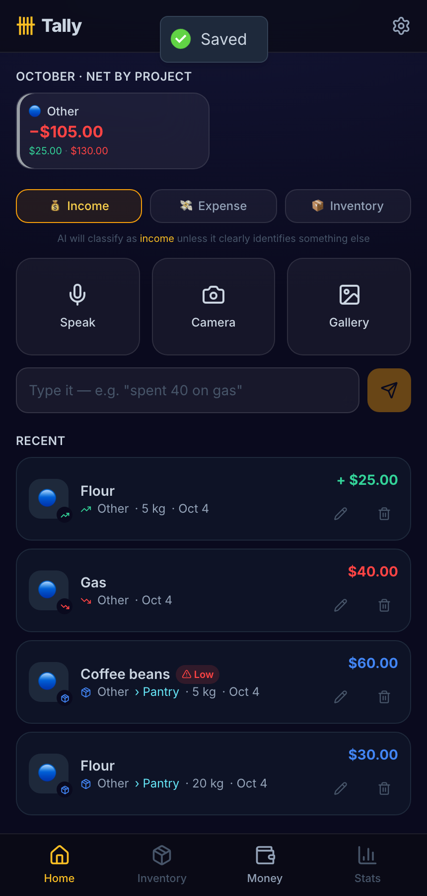
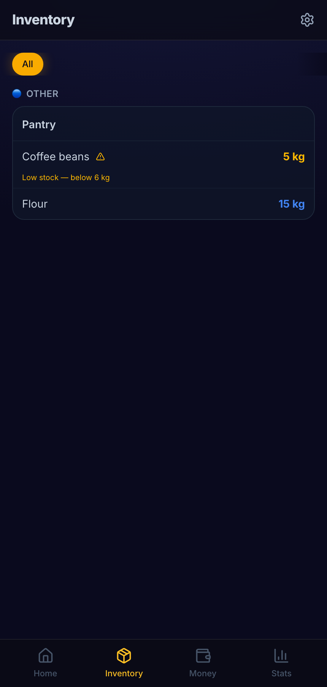
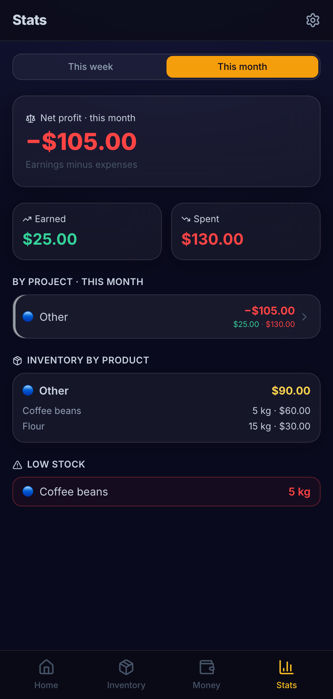
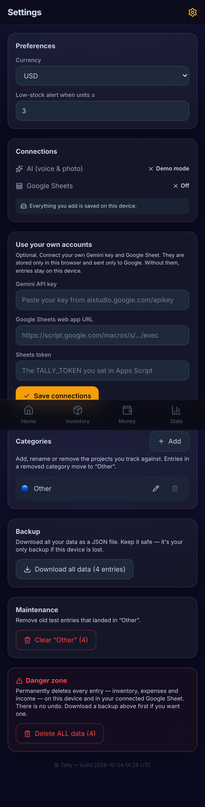

# Tally — Inventory & Money, tallied

**Live demo:** [tally-6y4.pages.dev](https://tally-6y4.pages.dev) — works instantly in local + demo mode, no account needed.

Tell it by **voice**, snap a **receipt photo**, or **type** it — Tally extracts the item,
quantity and cost, calculates totals, and saves it. Track your inventory and your spending
in one place, and mirror everything to a Google Sheet.

Built with React 19 + Vite + TypeScript + Tailwind v4 (installable PWA), Supabase (database),
Gemini (AI extraction), and a Google Apps Script (Sheets mirror).

## Screenshots

| Capture & recent | Inventory with low-stock alert | Stats | Your own accounts |
|---|---|---|---|
|  |  |  |  |

Taken in demo mode with a handful of sample entries typed into the app (nothing is connected to any
Google Sheet or database).

## Runs out of the box

With **no setup**, the app works in **local + demo mode**: data is saved on your device and a
simple parser pulls numbers out of typed text. Add the env vars below to unlock the real thing.

```bash
npm install
npm run dev      # http://localhost:5173
npm run build    # production build → dist/
```

## Use your own accounts (no code changes)

Open the app → **Settings → Use your own accounts** and paste your own **Gemini API key** and your own
**Google Sheets web app URL + token**. They are stored only in your browser and sent only to Google, so
anyone can try every feature with their own accounts without depending on the maintainer's. Nothing is
shared: the public demo does not write to anyone's spreadsheet.

## Unlock the full app (3 one-time steps)

Prefer build-time configuration? Copy `.env.example` to `.env.local` and fill in:

### 1. AI — voice & photo (Gemini)
- Get a free key: https://aistudio.google.com/apikey
- Set `VITE_GEMINI_API_KEY`.
- Without it, voice/photo are disabled and typed text uses the offline parser.

### 2. Cloud database (Supabase)
- Create a project at https://supabase.com.
- SQL Editor → run [`supabase/schema.sql`](supabase/schema.sql).
- Settings → API → copy the URL + anon key into `VITE_SUPABASE_URL` and `VITE_SUPABASE_ANON_KEY`.
- In the app → Settings → Cloud sync → create an account / sign in. Now data syncs and is backed up.

### 3. Google Sheets mirror
- Create a blank Google Sheet → Extensions → Apps Script.
- Paste [`google-apps-script/Code.gs`](google-apps-script/Code.gs).
- Project Settings → **Script properties** → add `SHEET_ID` (the long id in your sheet's URL) and
  `TALLY_TOKEN` (any long random string). Nothing secret lives in the code.
- Deploy → New deployment → **Web app**, execute as **Me**, access **Anyone**.
- Copy the Web app URL into `VITE_SHEETS_WEBHOOK_URL`.
- Every add/edit/delete now mirrors into the sheet, keyed by id.

## How it works

- **Capture** (`src/components/capture`) → sends text/audio/image to `extractEntries` (`src/lib/gemini.ts`).
- The AI returns one or more **drafts** → you confirm/fix them in a sheet → saved as **entries**.
- **Storage** (`src/lib/store.ts`) uses Supabase when signed in, else `localStorage`; every write
  also fires a mirror to the Sheet (`src/lib/sheets.ts`).
- Two record types: **inventory** (things you have, with quantity + low-stock alerts) and
  **expense** (money out). The **Stats** page totals spending by month and category.

## Deploy (Cloudflare Pages)

1. Cloudflare → Pages → Create → connect the `tally` GitHub repo.
2. Build command `npm run build`, output directory `dist`.
3. Settings → Environment variables → add a **secret** `GEMINI_API_KEY` (no `VITE_` prefix).
   The `functions/api/extract.ts` proxy reads it server-side, so the key is never in the
   browser bundle. (Do **not** set `VITE_GEMINI_API_KEY` in production.)
4. Optionally add `VITE_SUPABASE_URL`, `VITE_SUPABASE_ANON_KEY`, `VITE_SHEETS_WEBHOOK_URL`,
   `VITE_SHEETS_TOKEN`, `VITE_DEFAULT_CURRENCY`.
5. Every `git push` to `main` auto-deploys. Open the HTTPS URL on your phone → Share →
   Add to Home Screen to install it as an app (voice + camera work over HTTPS).

## Notes
- Voice uses `MediaRecorder` + Gemini (not the Web Speech API, which iOS Safari PWAs don't support).
- The confirmation screen exists so the AI never writes unverified data — you always approve first.
- In production, Gemini is called through `/api/extract` (a Cloudflare Pages Function) so the
  API key stays on the server. In local dev, `VITE_GEMINI_API_KEY` calls Gemini directly.
